# CS 411 — Stage 3: Database Implementation and Indexing

**Team 058 | Lights Out Trivia | October 30, 2026**

## 1. Database implementation

We implemented the Lights Out Trivia database on Google Cloud SQL using MySQL 8.4.11-google. The database is named `lights_out_trivia` and has 21 tables. Twelve contain imported Formula 1 records. The remaining tables support the application's users, questions, quizzes, attempts, and saved questions. We connected through the Cloud SQL Auth Proxy, ran the DDL and data import scripts, and checked the populated tables with SQL count queries.

| Table | Rows | Table | Rows |
|---|---:|---|---:|
| Season | 46 | Location | 75 |
| Circuit | 77 | Driver | 861 |
| Constructor | 212 | Race | 812 |
| Qualifying | 10,494 | DriverStanding | 1,324 |
| ConstructorStanding | 588 | RaceResult | 19,235 |
| Lap | 589,081 | PitStop | 11,371 |

We imported **634,176 rows** across the twelve populated tables. Five tables exceed the assignment's 1,000-row requirement: `Qualifying` (10,494), `DriverStanding` (1,324), `RaceResult` (19,235), `Lap` (589,081), and `PitStop` (11,371). The exact `CREATE TABLE` statements used for all 21 tables appear in **Appendix A**.

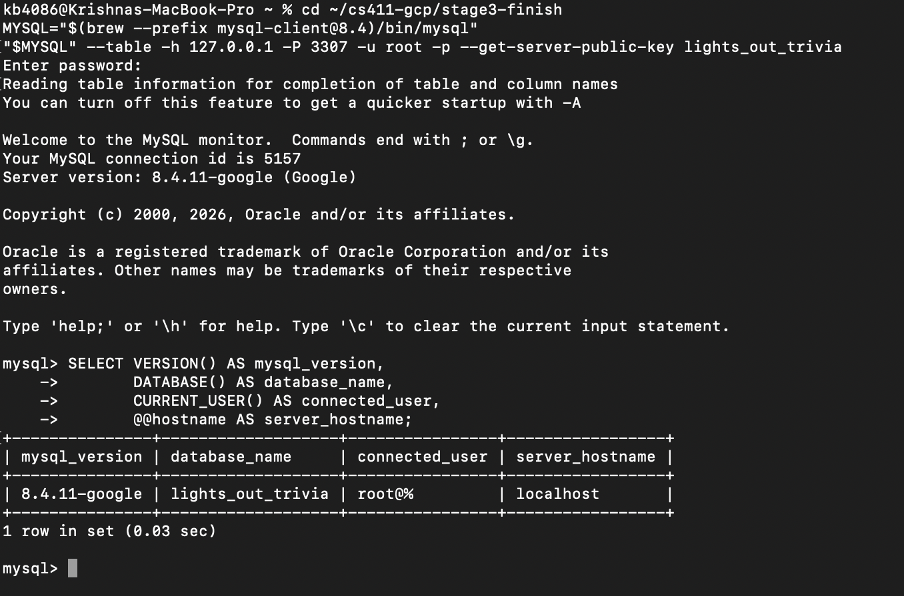

The connection shown was made through the Cloud SQL Auth Proxy.

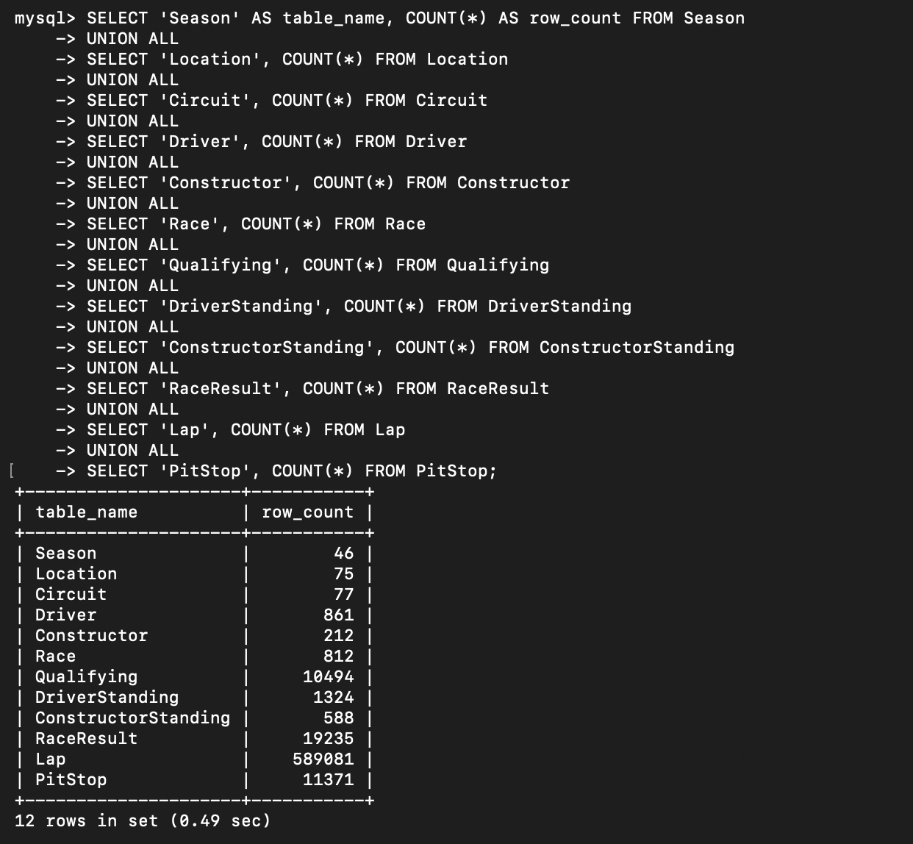

## 2. Three selected advanced SQL queries (Q1, Q3, and Q4)

We chose Q1, Q3, and Q4 from the five queries in our original SQL script. These three are relevant to F1 trivia generation, and each uses joins together with grouping or a subquery. We ran each query on MySQL with `LIMIT 15`. All three returned fifteen rows.

### Q1. Circuit Kings

This query finds the driver or drivers with the most wins at each circuit. It joins `RaceResult`, `Race`, `Circuit`, and `Driver`, groups the wins by driver and circuit, and uses a subquery in `HAVING` to find the winning count at that circuit. It can be used for a question such as “Who has won the most Grands Prix at Monaco?” The first recorded result was Lewis Hamilton with nine wins at Silverstone Circuit.

```sql
USE lights_out_trivia;

SELECT c.name    AS circuit,
       d.forename,
       d.surname,
       COUNT(*)  AS wins
FROM RaceResult rr
JOIN Race    r ON r.raceId    = rr.raceId
JOIN Circuit c ON c.circuitId = r.circuitId
JOIN Driver  d ON d.driverId  = rr.driverId
WHERE rr.finishPosition = 1
GROUP BY c.circuitId, c.name, d.driverId, d.forename, d.surname
HAVING COUNT(*) = (SELECT COUNT(*)
                   FROM RaceResult rr2
                   JOIN Race r2 ON r2.raceId = rr2.raceId
                   WHERE rr2.finishPosition = 1
                     AND r2.circuitId = c.circuitId
                   GROUP BY rr2.driverId
                   ORDER BY COUNT(*) DESC
                   LIMIT 1)
ORDER BY wins DESC, circuit
LIMIT 15;
```

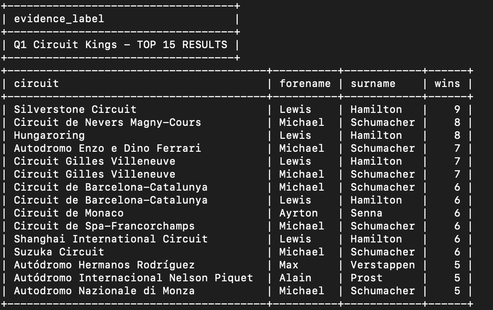

### Q3. Pit Stop Performance

This query compares each constructor's average pit stop duration with the average for the same season. It joins `PitStop`, `RaceResult`, `Race`, and `Constructor`, groups by year and constructor, and uses a subquery to calculate the season average. Stops lasting 60 seconds or more are excluded; a constructor must also have at least 20 recorded stops. The first recorded result was McLaren in 2024, with 77 stops and an average duration of 23.921 seconds.

```sql
USE lights_out_trivia;

SELECT r.year,
       con.name                        AS constructor,
       COUNT(*)                        AS stops,
       ROUND(AVG(ps.durationMs) / 1000, 3) AS avgStopSec
FROM PitStop ps
JOIN RaceResult  rr  ON rr.raceId = ps.raceId AND rr.driverId = ps.driverId
JOIN Race        r   ON r.raceId  = ps.raceId
JOIN Constructor con ON con.constructorId = rr.constructorId
WHERE ps.durationMs < 60000
GROUP BY r.year, con.constructorId, con.name
HAVING COUNT(*) >= 20
   AND AVG(ps.durationMs) < (SELECT AVG(ps2.durationMs)
                             FROM PitStop ps2
                             JOIN Race r2 ON r2.raceId = ps2.raceId
                             WHERE r2.year = r.year
                               AND ps2.durationMs < 60000)
ORDER BY r.year DESC, avgStopSec
LIMIT 15;
```

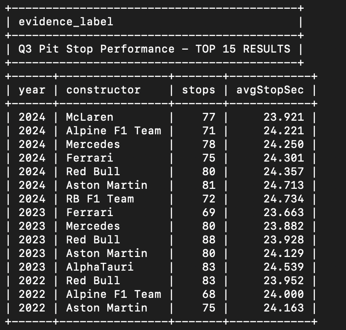

### Q4. Fastest Lap Specialists

This query counts how many times each driver set the fastest lap in a race, along with the first and last years in which they did so. We originally used a correlated subquery that calculated the minimum lap time for each lap record. We changed it to calculate the minimum once per race, then join those values back to `Lap`. The revised query still uses joins and `GROUP BY`. Its recorded top fifteen results matched the original query, including Lewis Hamilton's 66 fastest laps.

The **rewritten SQL below is the Q4 version used in all four official Q4 indexing tests**.

```sql
USE lights_out_trivia;

SELECT d.forename,
       d.surname,
       COUNT(*) AS fastestLaps,
       MIN(r.year) AS firstYear,
       MAX(r.year) AS lastYear
FROM Lap l
JOIN (
    SELECT raceId, MIN(lapTimeMs) AS bestLapTimeMs
    FROM Lap
    GROUP BY raceId
) best ON best.raceId = l.raceId
      AND best.bestLapTimeMs = l.lapTimeMs
JOIN Race r ON r.raceId = l.raceId
JOIN Driver d ON d.driverId = l.driverId
GROUP BY d.driverId, d.forename, d.surname
ORDER BY fastestLaps DESC, d.surname
LIMIT 15;
```

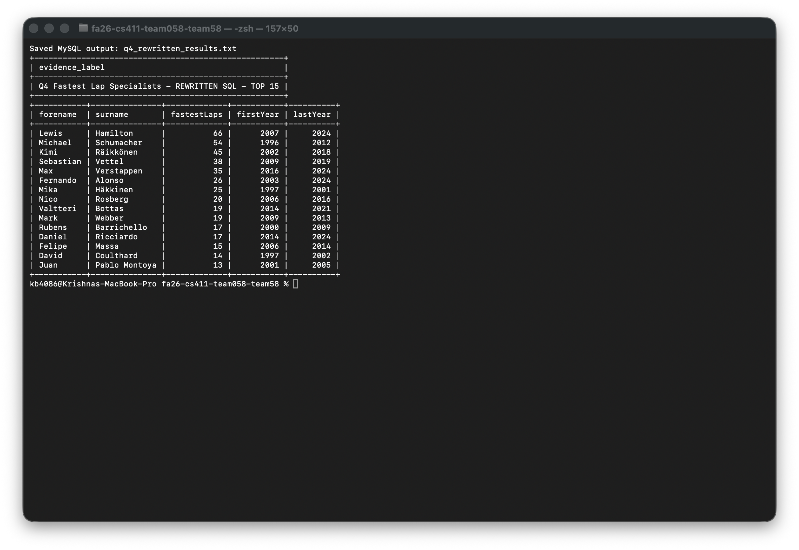

The displayed rows match the saved rewritten-Q4 result log at `doc/evidence/query-results/q4_rewritten_results.txt`.

## 3. Indexing experiments

For each of the three selected queries, we ran `EXPLAIN ANALYZE` using only the existing indexes and then with three different added index designs. We dropped each experimental index before testing the next design. This gave us twelve official query/index configurations. The supplementary experiments on the old version of Q4 are discussed separately in Section 5.

In these execution plans, MySQL did not show an estimated cost for the top-level `Limit`, `Sort`, and temporary-table steps. For comparison, we took the **estimated cost of the outermost `Nested loop inner join` iterator**, using the same type of node for each configuration of a given query. These are estimated join costs, not complete-query costs or milliseconds. The actual time is the elapsed time at the top-level `Limit` operator. We measured each configuration once, so timings alone are not enough to establish why a plan performed differently. In the tables, a positive cost-reduction percentage means the estimated join cost decreased; a negative percentage means it increased. Elapsed-time changes are also relative to baseline and are single-run observations.

### Q1. Circuit Kings

| Design | Index added | Estimated join cost | Actual time (ms) | Cost reduction | Elapsed-time change |
|---|---|---:|---:|---:|---:|
| Baseline | Existing indexes only | 3,507 | 106.0 | — | — |
| A | `RaceResult(finishPosition)` | 936 | 32.4 | 73.3% | −69.4% |
| B | `RaceResult(finishPosition, raceId)` | 936 | 32.3 | 73.3% | −69.5% |
| C | `RaceResult(finishPosition, driverId, raceId)` | 937 | 101.0 | 73.3% | −4.7% |

The baseline used `RaceResult`'s existing primary key to read the results for each race before filtering to `finishPosition = 1`. With Design A, MySQL used a covering lookup on the new `finishPosition` index instead. That lowered the estimated join cost from 3,507 to 936, a 73.3% decrease. Design B had the same rounded cost, while Design C was slightly higher at 937. `RaceResult` has a composite primary key of `(raceId, driverId)`, and InnoDB includes primary-key columns in secondary indexes, so adding `raceId` explicitly did not help here. Design C took 101.0 ms compared with 32.4 ms for A, despite nearly identical estimated costs. We cannot tell whether caching, execution conditions, or something else caused that difference from a single run. We chose **Design A** because it gave the lowest estimated cost without the additional index columns.

**`EXPLAIN ANALYZE` screenshots:**


### Q3. Pit Stop Performance

| Design | Index added | Estimated join cost | Actual time (ms) | Cost reduction | Elapsed-time change |
|---|---|---:|---:|---:|---:|
| Baseline | Existing indexes only | 5,141 | 77.0 | — | — |
| A | `PitStop(durationMs)` | 7,118 | 99.9 | −38.5% | +29.7% |
| B | `PitStop(durationMs, raceId)` | 7,121 | 104.0 | −38.5% | +35.1% |
| C | `PitStop(raceId, durationMs)` | 5,141 | 89.1 | 0.0% | +15.7% |

The baseline scanned `PitStop` and had an estimated join cost of 5,141. Designs A and B let MySQL use index range scans for `durationMs < 60000`, but their estimated costs increased to 7,118 and 7,121. The filter still keeps 10,854 of the table's 11,371 pit stops, roughly 95.5%, so the index does not skip much work. Design C used a covering index scan but did not change the estimated join cost. Its recorded runtime was also higher than the baseline. We kept the **existing indexes** for Q3 because none of the three new designs reduced estimated cost, and an unused index would take up space and add maintenance work.

**`EXPLAIN ANALYZE` screenshots:**


### Q4. Fastest Lap Specialists (rewritten query)

| Design | Index added | Estimated join cost | Actual time (ms) | Cost reduction | Elapsed-time change |
|---|---|---:|---:|---:|---:|
| Baseline | Existing indexes only | ≈9,840,000 | 308 | — | — |
| A | `Lap(raceId, lapTimeMs)` | 1,041 | 154 | ≈99.989% | −50.0% |
| B | `Lap(lapTimeMs, raceId)` | 859,136 | 263 | ≈91.3% | −14.6% |
| C | `Lap(raceId, driverId, lapTimeMs)` | ≈10,600,000 | 519 | ≈−7.7% | +68.5% |

These four tests used exactly the same rewritten Q4 query, so the estimated cost changes can be compared as indexing effects. The baseline estimated join cost was approximately 9.84 million. With Design A, MySQL used a covering index skip scan to find the minimum lap time for each race and a covering lookup on `(raceId, lapTimeMs)` to find the matching lap. That reduced the estimated join cost to 1,041, approximately 99.989% lower. Design B also reduced cost but could not support the per-race grouping as effectively with `lapTimeMs` first. Design C was worse than baseline because placing `driverId` between `raceId` and `lapTimeMs` prevented the same direct two-column lookup. We chose **Design A**. Its execution time fell from 308 ms to 154 ms, a 50% decrease in the recorded run. Estimated optimizer cost and measured time are different quantities; the 99.989% cost reduction does not mean the runtime improved by that same percentage.

**`EXPLAIN ANALYZE` screenshots:**


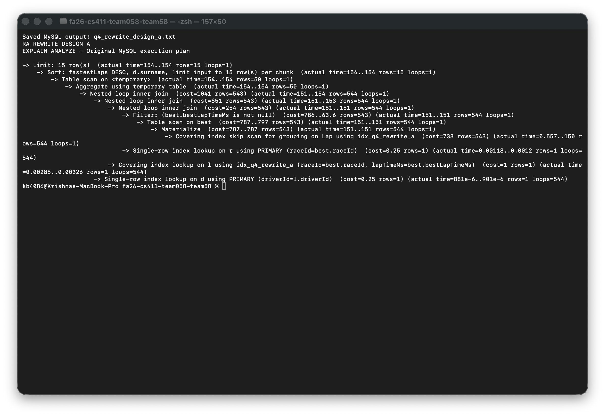

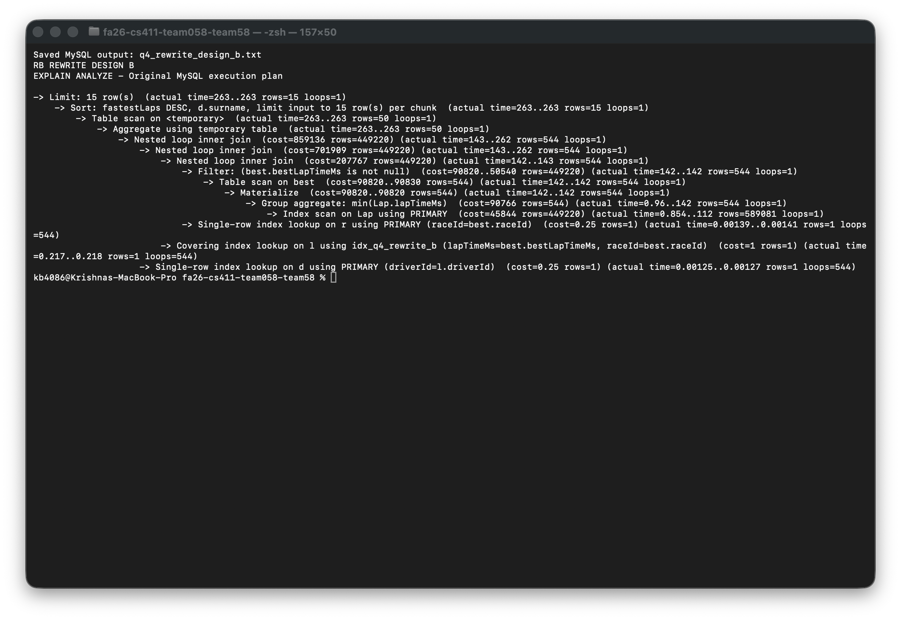

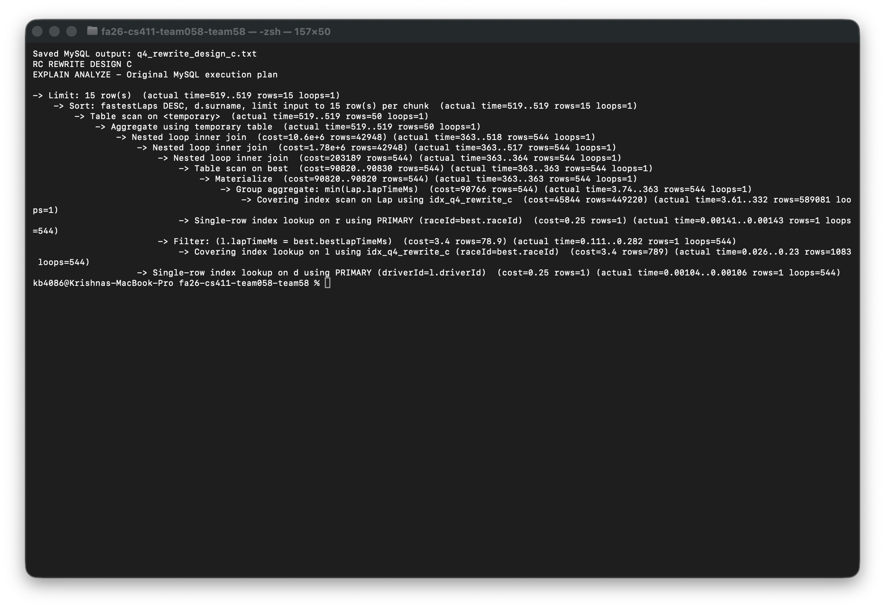

## 4. Final index selection

We selected one new index for Q1 and one for the rewritten Q4. Q3 retains its existing indexes.

```sql
CREATE INDEX idx_rr_finish_position
ON RaceResult(finishPosition);

CREATE INDEX idx_lap_race_time
ON Lap(raceId, lapTimeMs);
```

Both indexes were already created on Cloud SQL before this report. The Q1 screenshot confirms the visible BTREE on `RaceResult(finishPosition)`. During this audit, a read-only `SHOW INDEX` query on the authenticated MySQL session returned `idx_lap_race_time` on `Lap` with `raceId` then `lapTimeMs`, BTREE, visible YES. The saved Q4 verification screenshot shows the query and index columns; its far-right `Visible` field is clipped. The final-index SQL file contains only read-only `SHOW INDEX` checks; the documented `CREATE INDEX` definitions are commented out.

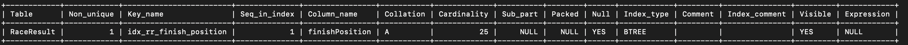

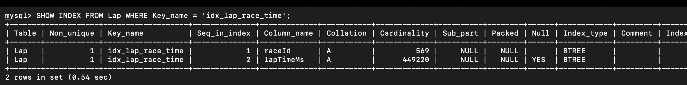

The authenticated session output returned two rows for `idx_lap_race_time`, with sequence 1 `raceId` and sequence 2 `lapTimeMs`, both BTREE. The screenshot is a crop of that genuine terminal output; its window width clips the far-right `Visible` field, which read `YES` in the complete query result.

## 5. Additional investigation of the original Q4

Our original Q4 used a dependent subquery for `MIN(lapTimeMs)`. `EXPLAIN ANALYZE` showed that MySQL executed it 589,081 times, and the query took 151,718 ms. In that first set of indexing tests, the reported estimated join cost remained 412,567 with all three experimental indexes. This result is still useful: adding an index does not guarantee that MySQL will choose it or that the estimated cost will decrease.

We then checked the original query again with `EXPLAIN FORMAT=TREE` without executing it. With an index on `Lap(raceId, lapTimeMs)`, the estimated outer join cost fell to 396,821, about 3.8% lower than 412,567. MySQL chose the composite index without a hint, and forcing the same index did not lower the estimate further. The earlier and later plans differed, but these records do not establish why. We kept these diagnostics separate because the assignment requires `EXPLAIN ANALYZE` for the measured indexing comparisons.

The rewritten query ran in 308 ms without a new index, and then in 154 ms with Design A. The large difference from the original 151,718 ms query mainly came from calculating each race minimum once instead of repeatedly. We do not count that change as an index-only improvement. The rewritten query also produced the same fifteen reported results as the original query. The original four plan screenshots and text outputs are retained under `doc/evidence/indexing/original-q4/` and are supplementary only.

### Original-Q4 plan screenshots (supplementary; not the official rewritten-Q4 comparison)

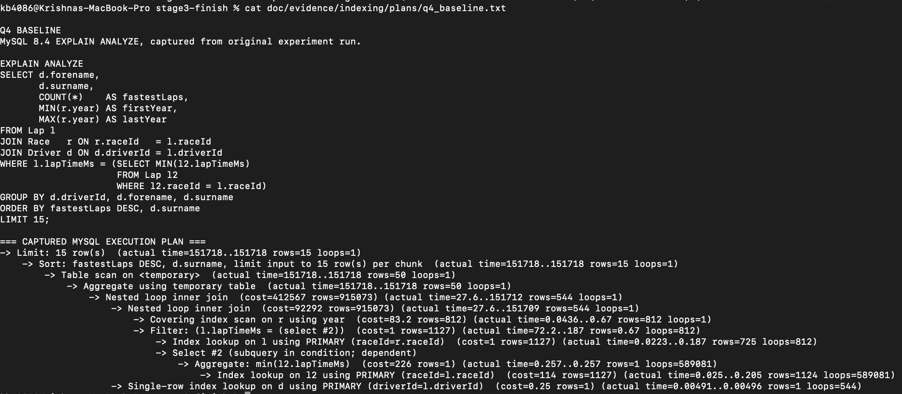
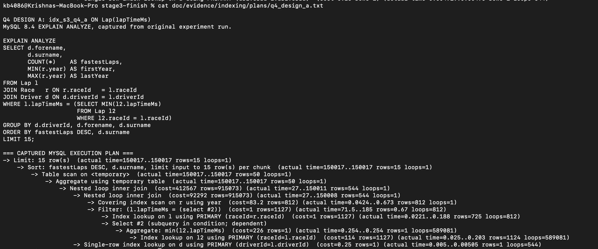
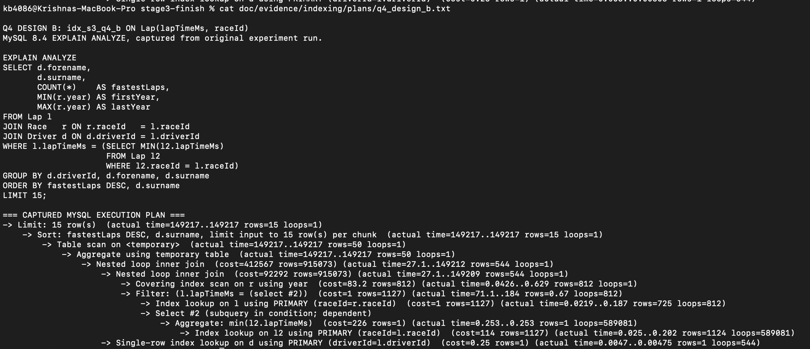


## 6. Evidence and reproducibility

The submitted SQL is in `sql/`: `ddl.sql`, `advanced_queries.sql`, `cs411_stage3_query_results.sql`, `cs411_stage3_indexing_experiments.sql`, `q4_rewrite_experiments.sql`, `cs411_stage3_final_index.sql`, `load_mysql.sql`, and `verify_counts.sql`. Saved plan text is under `doc/evidence/indexing/plans/`; the raw rewritten-Q4 log is `doc/evidence/indexing/q4_rewrite_results.txt`; the original-Q4 plan set and diagnostics are under `doc/evidence/indexing/original-q4/`. Database connection, row counts, and query results are under `doc/evidence/`.

The populated CSV dataset was generated from the team-provided Kaggle data using the team's ETL with the 1979–2024 filter. It remains in the local `mysql-import/tables/` package rather than being committed; the 12 table counts and Cloud SQL screenshots document the imported database. The import script expects those CSVs in a sibling `tables/` directory when run from the import package root. Application tables remain empty.

The four Q1 screenshots, four Q3 screenshots, and four rewritten-Q4 screenshots are the twelve official configurations. Original correlated-Q4 screenshots and plans are explicitly supplementary and stored separately. The original saved experiment identifiers are abbreviated as follows: `R0` is the rewritten-Q4 baseline, `RA` is rewritten-Q4 Design A, `RB` is Design B, and `RC` is Design C. The original logs retain these identifiers; the final report and filenames use the clearer Q4 baseline/A/B/C naming convention. The recorded plan bodies, costs, and timings are preserved. Both final indexes are deployed; the Q4 final-index screenshot is a read-only capture of the authenticated MySQL verification query.

## Appendix A. DDL commands for all 21 tables

The following SQL is the schema creation script used for the Cloud SQL database.

```sql
-- Lights Out Trivia (Team 058) - Stage 3 DDL
-- Transcribed from the Stage 2 relational schema. Target: MySQL 8.0+.

-- ---------- Formula 1 data relations ----------

CREATE TABLE Season (
    year    INT PRIMARY KEY,
    wikiUrl VARCHAR(2048)
);

CREATE TABLE Location (
    location VARCHAR(100) PRIMARY KEY,
    country  VARCHAR(100)
);

CREATE TABLE Circuit (
    circuitId  INT PRIMARY KEY,
    circuitRef VARCHAR(100) NOT NULL UNIQUE,
    name       VARCHAR(255),
    location   VARCHAR(100),
    latitude   DECIMAL(10,7),
    longitude  DECIMAL(10,7),
    altitudeM  INT,
    wikiUrl    VARCHAR(2048),
    FOREIGN KEY (location) REFERENCES Location(location)
);

CREATE TABLE Driver (
    driverId        INT PRIMARY KEY,
    driverRef       VARCHAR(100) NOT NULL UNIQUE,
    code            VARCHAR(3),
    permanentNumber INT,
    forename        VARCHAR(100),
    surname         VARCHAR(100),
    dateOfBirth     DATE,
    nationality     VARCHAR(100),
    wikiUrl         VARCHAR(2048)
);

CREATE TABLE Constructor (
    constructorId  INT PRIMARY KEY,
    constructorRef VARCHAR(100) NOT NULL UNIQUE,
    name           VARCHAR(255),
    nationality    VARCHAR(100),
    wikiUrl        VARCHAR(2048)
);

CREATE TABLE Race (
    raceId    INT PRIMARY KEY,
    year      INT NOT NULL,
    circuitId INT NOT NULL,
    round     INT NOT NULL,
    name      VARCHAR(255),
    raceDate  DATE,
    raceTime  TIME,
    wikiUrl   VARCHAR(2048),
    UNIQUE (year, round),
    FOREIGN KEY (year)      REFERENCES Season(year),
    FOREIGN KEY (circuitId) REFERENCES Circuit(circuitId)
);

CREATE TABLE Qualifying (
    raceId   INT,
    driverId INT,
    position INT,
    q1TimeMs INT,
    q2TimeMs INT,
    q3TimeMs INT,
    PRIMARY KEY (raceId, driverId),
    FOREIGN KEY (raceId)   REFERENCES Race(raceId),
    FOREIGN KEY (driverId) REFERENCES Driver(driverId)
);

CREATE TABLE DriverStanding (
    year     INT,
    driverId INT,
    position INT,
    points   DECIMAL(10,2),
    PRIMARY KEY (year, driverId),
    FOREIGN KEY (year)     REFERENCES Season(year),
    FOREIGN KEY (driverId) REFERENCES Driver(driverId)
);

CREATE TABLE ConstructorStanding (
    year          INT,
    constructorId INT,
    position      INT,
    points        DECIMAL(10,2),
    PRIMARY KEY (year, constructorId),
    FOREIGN KEY (year)          REFERENCES Season(year),
    FOREIGN KEY (constructorId) REFERENCES Constructor(constructorId)
);

CREATE TABLE RaceResult (
    raceId         INT,
    driverId       INT,
    constructorId  INT NOT NULL,
    carNumber      INT,
    gridPosition   INT,
    finishPosition INT,
    positionOrder  INT,
    points         DECIMAL(10,2),
    lapsCompleted  INT,
    raceTimeMs     INT,
    status         VARCHAR(100),
    PRIMARY KEY (raceId, driverId),
    FOREIGN KEY (raceId)        REFERENCES Race(raceId),
    FOREIGN KEY (driverId)      REFERENCES Driver(driverId),
    FOREIGN KEY (constructorId) REFERENCES Constructor(constructorId)
);

CREATE TABLE Lap (
    raceId       INT,
    driverId     INT,
    lapNumber    INT,
    position     INT,
    lapTimeMs    INT,
    sector1Ms    INT,
    sector2Ms    INT,
    sector3Ms    INT,
    tyreCompound VARCHAR(30),
    tyreLifeLaps INT,
    trackStatus  VARCHAR(20),
    speedTrapKph DECIMAL(7,3),
    PRIMARY KEY (raceId, driverId, lapNumber),
    FOREIGN KEY (raceId, driverId) REFERENCES RaceResult(raceId, driverId)
);

CREATE TABLE PitStop (
    raceId     INT,
    driverId   INT,
    lapNumber  INT,
    durationMs INT,
    timeOfDay  TIME,
    PRIMARY KEY (raceId, driverId, lapNumber),
    FOREIGN KEY (raceId, driverId, lapNumber) REFERENCES Lap(raceId, driverId, lapNumber)
);

CREATE TABLE TelemetrySample (
    raceId      INT,
    driverId    INT,
    lapNumber   INT,
    offsetMs    INT,
    speedKph    DECIMAL(7,3),
    rpm         INT,
    gear        INT,
    throttlePct DECIMAL(5,2),
    brakeOn     BOOLEAN,
    drsState    INT,
    posX        DECIMAL(12,3),
    posY        DECIMAL(12,3),
    PRIMARY KEY (raceId, driverId, lapNumber, offsetMs),
    FOREIGN KEY (raceId, driverId, lapNumber) REFERENCES Lap(raceId, driverId, lapNumber)
);

-- ---------- Application relations ----------

CREATE TABLE User (
    userId       INT PRIMARY KEY,
    username     VARCHAR(50)  NOT NULL UNIQUE,
    email        VARCHAR(254) NOT NULL UNIQUE,
    passwordHash VARCHAR(255) NOT NULL,
    country      VARCHAR(100),
    isAdmin      BOOLEAN NOT NULL DEFAULT FALSE,
    createdAt    TIMESTAMP DEFAULT CURRENT_TIMESTAMP
);

CREATE TABLE Question (
    questionId  INT PRIMARY KEY,
    authorId    INT,
    raceId      INT,
    driverId    INT,
    lapNumber   INT,
    text        TEXT NOT NULL,
    format      VARCHAR(30),
    category    VARCHAR(100),
    difficulty  VARCHAR(20),
    explanation TEXT,
    visibility  VARCHAR(20),
    sourceKey   VARCHAR(255) UNIQUE,
    createdAt   TIMESTAMP DEFAULT CURRENT_TIMESTAMP,
    FOREIGN KEY (authorId) REFERENCES User(userId),
    FOREIGN KEY (raceId, driverId, lapNumber) REFERENCES Lap(raceId, driverId, lapNumber)
);

CREATE TABLE Quiz (
    quizId        INT PRIMARY KEY,
    ownerId       INT,
    driverId      INT,
    constructorId INT,
    title         VARCHAR(255) NOT NULL,
    description   TEXT,
    quizType      VARCHAR(30),
    visibility    VARCHAR(20),
    category      VARCHAR(100),
    eraStartYear  INT,
    eraEndYear    INT,
    createdAt     TIMESTAMP DEFAULT CURRENT_TIMESTAMP,
    FOREIGN KEY (ownerId)       REFERENCES User(userId),
    FOREIGN KEY (driverId)      REFERENCES Driver(driverId),
    FOREIGN KEY (constructorId) REFERENCES Constructor(constructorId)
);

CREATE TABLE QuizQuestion (
    quizId     INT,
    questionId INT,
    position   INT,
    PRIMARY KEY (quizId, questionId),
    FOREIGN KEY (quizId)     REFERENCES Quiz(quizId),
    FOREIGN KEY (questionId) REFERENCES Question(questionId)
);

CREATE TABLE AnswerOption (
    questionId INT,
    label      VARCHAR(10),
    text       TEXT NOT NULL,
    isCorrect  BOOLEAN NOT NULL,
    PRIMARY KEY (questionId, label),
    FOREIGN KEY (questionId) REFERENCES Question(questionId)
);

CREATE TABLE QuizAttempt (
    attemptId   INT PRIMARY KEY,
    quizId      INT NOT NULL,
    userId      INT NOT NULL,
    startedAt   TIMESTAMP NULL,
    completedAt TIMESTAMP NULL,
    FOREIGN KEY (quizId) REFERENCES Quiz(quizId),
    FOREIGN KEY (userId) REFERENCES User(userId)
);

CREATE TABLE AttemptAnswer (
    attemptId     INT,
    questionId    INT,
    selectedLabel VARCHAR(10),
    timeTakenMs   INT,
    PRIMARY KEY (attemptId, questionId),
    FOREIGN KEY (attemptId) REFERENCES QuizAttempt(attemptId),
    FOREIGN KEY (questionId) REFERENCES Question(questionId),
    FOREIGN KEY (questionId, selectedLabel) REFERENCES AnswerOption(questionId, label)
);

CREATE TABLE Favorite (
    userId     INT,
    questionId INT,
    savedAt    TIMESTAMP DEFAULT CURRENT_TIMESTAMP,
    PRIMARY KEY (userId, questionId),
    FOREIGN KEY (userId)     REFERENCES User(userId),
    FOREIGN KEY (questionId) REFERENCES Question(questionId)
);
```
