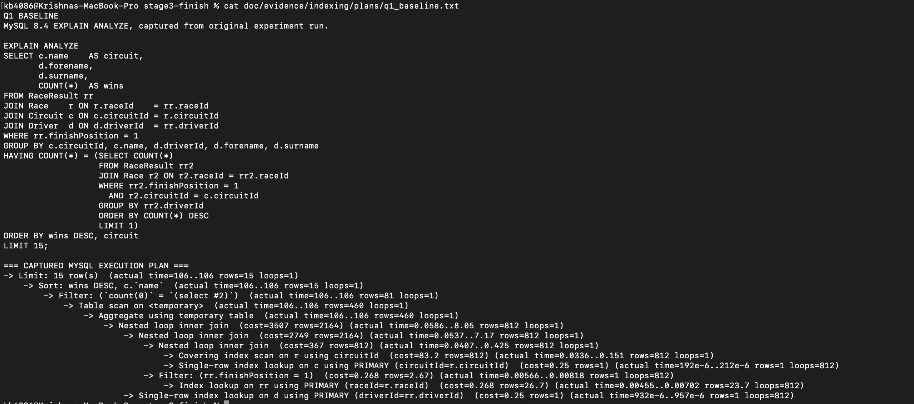
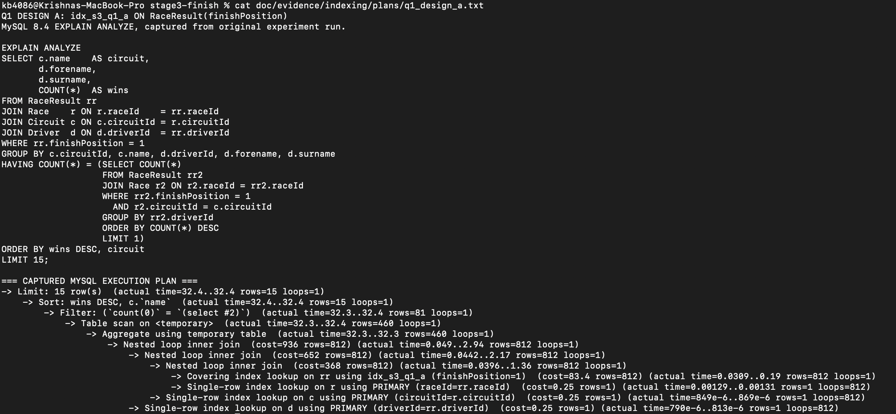
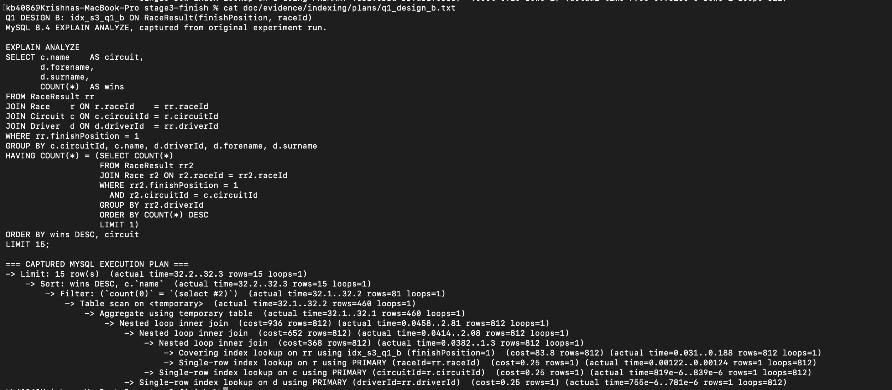
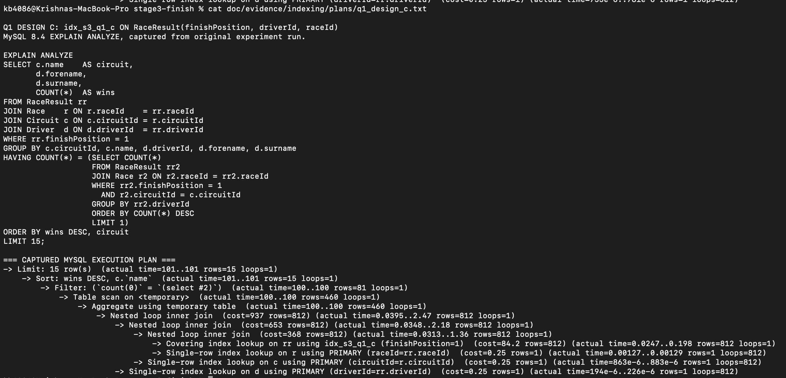
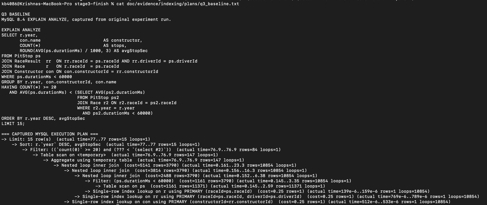
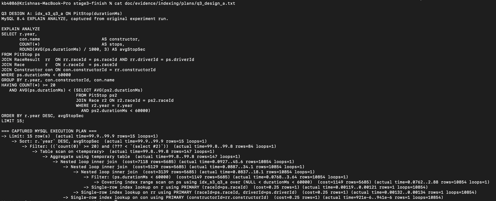
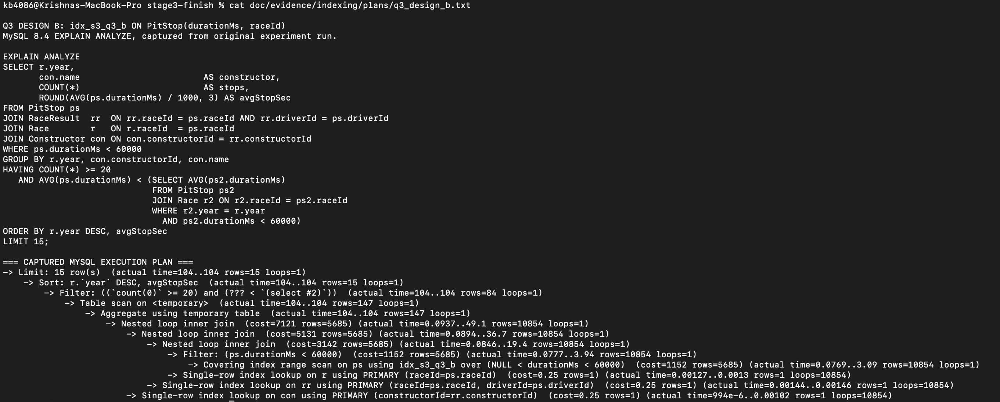
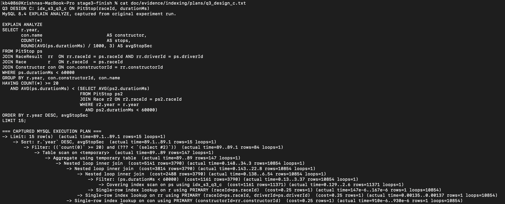
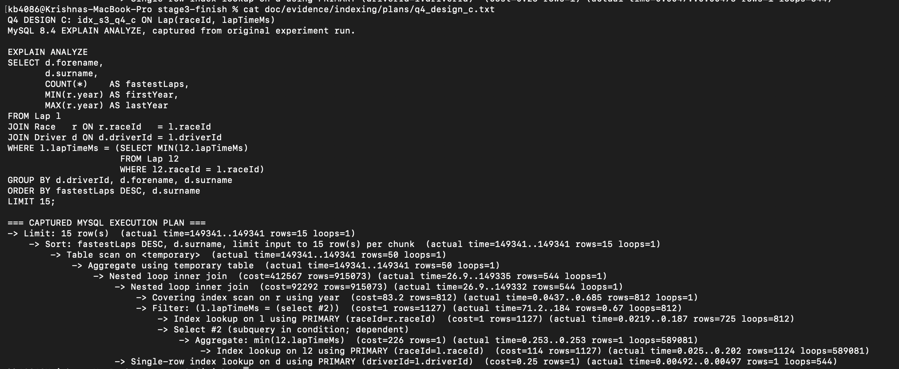

# Stage 3: Indexing Analysis (Team 058)

This section is intended to be merged into `doc/Database Design.md` alongside the DDL, database evidence, and the top-15 advanced-query results. It documents *only* the indexing work for Q1, Q3, and Q4.

**Environment.** Google Cloud SQL, MySQL 8.4.11-google; `lights_out_trivia`; the populated tables include 19,235 `RaceResult`, 11,371 `PitStop`, and 589,081 `Lap` records. The original queries are Q1, Q3, and Q4 in `advanced_queries.sql`. The experiments are reproducible using `sql/cs411_stage3_indexing_experiments.sql`.

**Measurement convention.** MySQL `EXPLAIN ANALYZE` emits an iterator tree. Because the top-level `Limit`, `Sort`, and temporary-table operators do not display optimizer-estimated cost here, the table below uses the cost of the *outermost `Nested loop inner join` iterator* in each plan, consistently across the four configurations of each query. These figures are **not whole-query optimizer costs** and are not milliseconds. Actual time is the completion time in the top-level `Limit` iterator (ms), supplied as secondary context. This is one measurement per configuration; small timing differences can be noise. Each experimental index was dropped before the next design.

## Measurements

| Query | Configuration | Added index | Estimated join cost | Actual time (ms) | Estimated cost change vs. baseline |
|---|---|---|---:|---:|---:|
| Q1 | Baseline | `Existing indexes only` | 3,507 | 106.0 | — |
| Q1 | Design A | `RaceResult(finishPosition)` | 936 | 32.4 | +73.3% |
| Q1 | Design B | `RaceResult(finishPosition, raceId)` | 936 | 32.3 | +73.3% |
| Q1 | Design C | `RaceResult(finishPosition, driverId, raceId)` | 937 | 101.0 | +73.3% |
| Q3 | Baseline | `Existing indexes only` | 5,141 | 77.0 | — |
| Q3 | Design A | `PitStop(durationMs)` | 7,118 | 99.9 | -38.5% |
| Q3 | Design B | `PitStop(durationMs, raceId)` | 7,121 | 104.0 | -38.5% |
| Q3 | Design C | `PitStop(raceId, durationMs)` | 5,141 | 89.1 | 0.0% |
| Q4 | Baseline | `Existing indexes only` | 412,567 | 151,718.0 | — |
| Q4 | Design A | `Lap(lapTimeMs)` | 412,567 | 150,017.0 | 0.0% |
| Q4 | Design B | `Lap(lapTimeMs, raceId)` | 412,567 | 149,217.0 | 0.0% |
| Q4 | Design C | `Lap(raceId, lapTimeMs)` | 412,567 | 149,341.0 | 0.0% |

## Q1. Circuit Kings

The Q1 baseline plan had an estimated join cost of 3,507. MySQL scanned races and used `RaceResult`'s existing primary-key index to retrieve results for each race, then filtered to `finishPosition = 1`. Design A added `RaceResult(finishPosition)`. MySQL changed the access path to a covering lookup on `idx_s3_q1_a` for `finishPosition = 1`, reducing the estimated join cost to 936, a 73.3% decrease. Design B, which also included `raceId`, had the same rounded total cost of 936, and Design C was slightly higher at 937. The observed completion times were 106 ms at baseline, 32.4 ms with A, 32.3 ms with B, and 101 ms with C. As InnoDB secondary indexes already include primary-key columns, adding explicit `raceId` did not provide a measurable estimated-cost advantage here. We select Design A as the simplest index with the lowest observed estimated cost.

## Q3. Pit Stop Performance

The Q3 baseline used a scan of `PitStop` and an estimated join cost of 5,141. Designs A and B indexed `durationMs` first. MySQL used those indexes for a range scan but increased the estimated join cost to 7,118 and 7,121, respectively. The query retains 10,854 of the 11,371 pit stops under the `durationMs < 60000` filter, so the index is not selective; most rows still need to be joined and grouped. Design C, `PitStop(raceId, durationMs)`, matched the baseline join cost of 5,141 and used a covering index scan, but did not reduce estimated cost. Recorded execution times also did not show an improvement for any design (77 ms baseline; 99.9, 104, and 89.1 ms for A, B, and C). We therefore retain the default indexes for this query rather than add an index that increases maintenance overhead without a demonstrated benefit.

## Q4. Fastest Lap Specialists

Q4 had a baseline estimated join cost of 412,567 and a completion time of 151,718 ms. Each experimental index design produced the same estimated join cost, 412,567, and none of the added indexes was chosen in the displayed plan. The expensive dependent subquery computing `MIN(lapTimeMs)` ran **589,081 times**, with MySQL repeatedly using the original `Lap` primary key to find rows for each race. Designs A, B, and C completed in 150,017, 149,217, and 149,341 ms, respectively, which are relatively small timing changes given the approximately 150-second query duration and one run per configuration. Even the index on `(raceId, lapTimeMs)` was not selected by the optimizer for this particular query plan. We therefore do not retain any of the three new indexes for Q4. A query rewrite that computes each race minimum only once would be a separate optimization experiment and is not claimed as a measured improvement in this report.

## Final index design

The selected additional index is `CREATE INDEX idx_rr_finish_position ON RaceResult(finishPosition);`. This keeps the Q1 cost reduction without the wider indexes tested in Designs B and C. We retain MySQL’s default primary-key and foreign-key indexes for Q3 and Q4 because the experiments gave no lower optimizer-estimated join cost. Create the selected index **after** the experiments using the final-index SQL script, then verify its presence separately with `SHOW INDEX FROM RaceResult;` and include the resulting evidence. The final design aims to improve relevant trivia-question generation while avoiding added indexes with no measured benefit.

## Screenshots and artifacts to insert

Insert 12 readable screenshots of the captured `EXPLAIN ANALYZE` plans (Q1, Q3, Q4; baseline and Designs A–C), taken from the preserved original output. Put image files under `doc/evidence/indexing/screenshots/` using the filenames below. Each screenshot must visibly identify its query and configuration and show the relevant estimated cost and access path. The SQL script and raw text evidence provide the full commands and original execution plans. The following image links will display after the screenshot files are added.

- Q1 Baseline: `doc/evidence/indexing/screenshots/q1_baseline.png`
- Q1 Design A: `doc/evidence/indexing/screenshots/q1_design_a.png`
- Q1 Design B: `doc/evidence/indexing/screenshots/q1_design_b.png`
- Q1 Design C: `doc/evidence/indexing/screenshots/q1_design_c.png`
- Q3 Baseline: `doc/evidence/indexing/screenshots/q3_baseline.png`
- Q3 Design A: `doc/evidence/indexing/screenshots/q3_design_a.png`
- Q3 Design B: `doc/evidence/indexing/screenshots/q3_design_b.png`
- Q3 Design C: `doc/evidence/indexing/screenshots/q3_design_c.png`
- Q4 Baseline: `doc/evidence/indexing/screenshots/q4_baseline.png`
- Q4 Design A: `doc/evidence/indexing/screenshots/q4_design_a.png`
- Q4 Design B: `doc/evidence/indexing/screenshots/q4_design_b.png`
- Q4 Design C: `doc/evidence/indexing/screenshots/q4_design_c.png`

### Execution-plan screenshots

Also include screenshots of the GCP MySQL connection, table counts, three top-15 query outputs, and final-index verification in the team’s `doc/Database Design.md` or its evidence directory.

**Source:** The experimental SQL and `cs411_indexing_results.txt` generated on MySQL 8.4.11-google. These results do not establish whole-query estimated cost, repeated-run statistical significance, or performance of any untested rewrite.
